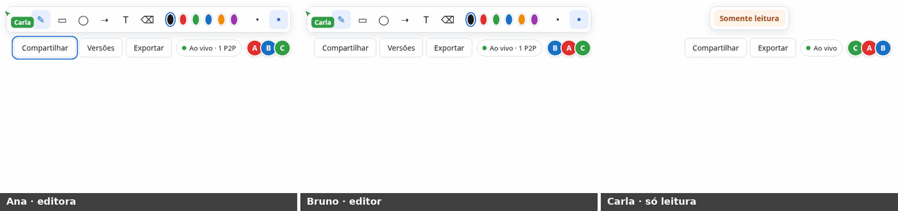
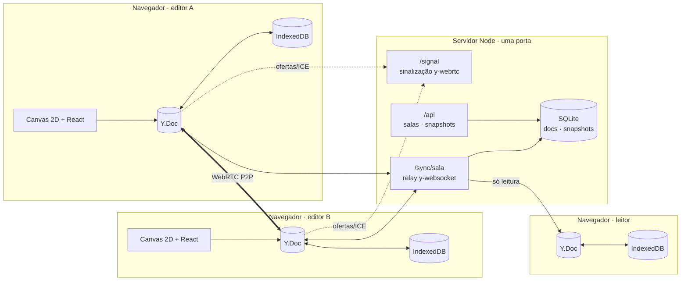

# Quadro Colaborativo — tempo real com CRDTs (Yjs) e WebRTC

Quadro branco multiusuário no estilo Excalidraw/Miro. Várias pessoas desenham ao mesmo tempo, com o cursor de cada uma visível na tela. O quadro funciona sem internet e se reconcilia sozinho quando a conexão volta, sem conflitos.



## O problema

Colaboração em tempo real tem três dificuldades:

1. **Edição concorrente:** duas pessoas mexem no mesmo objeto ao mesmo tempo, e ninguém pode perder trabalho.
2. **Rede instável:** alguém fica offline, continua desenhando e volta depois.
3. **Custo e latência:** passar cada traço por um servidor central custa banda e acrescenta atraso.

Para isso, o projeto combina um CRDT (Yjs), que dá convergência garantida sem servidor de autoridade, com WebRTC, por onde os editores trocam alterações direto entre os navegadores. Um relay WebSocket próprio entra como alternativa quando o P2P falha e também aplica as permissões.

## Funcionalidades

- **Ferramentas:** caneta livre, retângulo, elipse, seta, texto, borracha e seleção/mover (atalhos V P R O A T E; Delete apaga a seleção).
- **Presença:** cursores com nome e cor e a lista de quem está na sala, pelo awareness do Yjs.
- **Offline-first:** o estado fica no IndexedDB (y-indexeddb). Dá para recarregar a página sem internet, e tudo sobe ao reconectar.
- **Salas por link:** dois links por sala, **editor** e **leitor**, assinados com HMAC. O servidor recusa alterações vindas de leitores.
- **Desfazer/refazer por usuário:** `Y.UndoManager` rastreia só a origem local. O Ctrl+Z da Ana nunca desfaz o desenho do Bruno.
- **Exportar PNG/SVG**, recortado ao conteúdo. O PNG é gerado a partir do mesmo SVG.
- **Histórico de versões:** snapshots nomeados no servidor (SQLite). Restaurar uma versão também se desfaz com Ctrl+Z.

## Arquitetura



Fluxo de um traço: o `Canvas` grava o elemento no `Y.Doc` local com a origem do usuário (que entra no desfazer dele). O Yjs gera um update binário que vai, em paralelo, para o IndexedDB, para os pares WebRTC e para o relay. Quem recebe o mesmo update por dois caminhos não tem problema, porque aplicar um update do Yjs é idempotente.

### Modelo de dados

O `Y.Doc` tem um único `Y.Map<id, Y.Map>` chamado `elements`, e cada elemento é um `Y.Map` próprio:

| campo            | tipo                                      | observação                                           |
| ---------------- | ----------------------------------------- | ---------------------------------------------------- |
| `kind`           | `pen \| rect \| ellipse \| arrow \| text` |                                                      |
| `points`         | `number[]`                                | lista plana `x0,y0,x1,y1,…`; mover = deslocar pontos |
| `color`, `width` | `string`, `number`                        |                                                      |
| `z`              | `number`                                  | empilhamento; empate resolvido pelo `id`             |
| `text`, `size`   | opcional                                  | só texto                                             |
| `author`         | `string`                                  | nome de quem criou                                   |

Como cada elemento é um mapa separado, edições concorrentes em **campos diferentes** se combinam (um move, outro troca a cor). No **mesmo campo**, vale a última escrita conforme a ordem do Yjs, igual em todos os clientes. Dados vindos da rede passam por `isElement()` antes de serem desenhados.

### Estrutura de pastas

```
shared/   modelo do quadro (Board/Yjs), geometria, exportação SVG, formato dos links
src/      React + Canvas 2D: board/ (canvas, ferramentas, render, export), sync/ (conexão, presença), panels/
server/   http + ws numa porta: tokens.ts, relay.ts, signaling.ts, store.ts (node:sqlite), app.ts
tests/    Vitest: unitários (geometria, Board, SVG) e integração (servidor real + y-websocket)
e2e/      Playwright: 3 navegadores na mesma sala, offline, versões/exportação
```

## Por que CRDT e não OT?

|                     | **OT (Operational Transformation)**                                         | **CRDT (Yjs)**                                                               |
| ------------------- | --------------------------------------------------------------------------- | ---------------------------------------------------------------------------- |
| Convergência        | um servidor central ordena e transforma as operações                        | matemática: updates comutam, qualquer ordem dá o mesmo estado                |
| P2P                 | difícil, porque precisa de uma autoridade                                   | natural: os pares trocam updates direto                                      |
| Offline longo       | as operações pendentes têm de ser transformadas contra tudo o que aconteceu | o update offline é aplicado ao voltar e converge                             |
| Complexidade        | funções de transformação por tipo de operação (fáceis de errar)             | a biblioteca resolve; o modelo de dados vira a decisão principal             |
| Custo               | servidor sempre no caminho                                                  | metadados extras no documento (tombstones), compactados pelo Yjs             |
| Intenção do usuário | o servidor pode aplicar regras de negócio na hora                           | regras ficam no cliente ou num relay que filtra (o que fazemos com leitores) |

Para um quadro branco com P2P e offline como requisitos, o CRDT é o encaixe natural. O OT faz mais sentido quando já existe um servidor central obrigatório e é preciso validar cada operação, como no Google Docs. O custo aceito aqui é o crescimento do documento com o histórico, o que mitigamos com snapshots.

## Permissões: editor e leitor

- O token do link é `<papel>.<HMAC-SHA256(ROOM_SECRET, "<sala>:<papel>")>`. É sem estado (a sala não precisa estar cadastrada) e não dá para falsificar sem o segredo.
- **Relay:** de um leitor, o servidor aceita só o pedido de sincronização (step 1) e a presença. Os step 2 e updates são descartados. Há teste de integração disso.
- **WebRTC:** a sinalização só aceita **token de editor**, e só no tópico da própria sala. Um leitor nunca entra na malha P2P, então não tem como empurrar updates para os pares.
- **Mesmo navegador:** o provider do leitor desliga o BroadcastChannel, para não alcançar abas de editor.

## WebRTC, STUN/TURN e NAT simétrico

O y-webrtc conecta os pares com ICE. Com só **STUN** (padrão: `stun.l.google.com`), a conexão direta funciona na maioria das redes domésticas. Mas **NAT simétrico** (redes corporativas, 4G/CGNAT de algumas operadoras) troca a porta de saída para cada destino, e o furo de NAT falha. Nesses casos é preciso um servidor **TURN**, que retransmite a mídia e tem custo de banda.

O projeto trata isso de duas formas:

1. `VITE_ICE_SERVERS` aceita qualquer lista de servidores ICE, inclusive TURN (`{"urls":"turn:…","username":"…","credential":"…"}`).
2. **Mesmo sem TURN, nada quebra:** o relay WebSocket está sempre conectado e entrega os mesmos updates. O selo de status mostra `Ao vivo · N P2P` quando há pares diretos e `Ao vivo` quando tudo vai pelo relay. Se o servidor cair com pares já conectados, o quadro segue ao vivo por P2P e mostra `Sem servidor · N P2P`.

## Como rodar

Requisitos: Node **22.18+**. O servidor roda TypeScript direto, por type stripping, e usa o `node:sqlite` nativo, sem compilação.

```bash
cp .env.example .env              # e troque ROOM_SECRET (openssl rand -hex 32)
npm install
npm run dev                       # Vite (5173) + servidor (4444) num comando só
# abra http://localhost:5173, clique em "Criar sala" e abra o link em outra aba ou navegador
```

Produção / um comando:

```bash
npm run build && npm start        # tudo em http://localhost:4444
docker compose up --build         # mesma coisa em contêiner (ROOM_SECRET vem do .env)
```

| comando                                       | o que faz                                                                      |
| --------------------------------------------- | ------------------------------------------------------------------------------ |
| `npm test`                                    | Vitest: 21 testes unitários e de integração (servidor real em porta aleatória) |
| `npm run test:e2e`                            | Playwright: build + servidor na porta 4555, 3 cenários com vários navegadores  |
| `npm run lint` · `typecheck` · `format:check` | ESLint (typescript-eslint strict), `tsc` app e servidor, Prettier              |

A CI (GitHub Actions) roda formatação, lint, tipos, testes, build e E2E.

### Teste manual com rede lenta

Abra duas abas na mesma sala. No DevTools de uma delas, vá em **Network → Throttling → Slow 3G** (ou **Offline**). Desenhe nas duas e volte para "No throttling": os traços convergem. Com **Offline**, o canal WebRTC já aberto continua de pé (o selo mostra `Sem servidor · 1 P2P`). Para isolar o caso offline de verdade, use uma aba sozinha ou feche a outra.

## Trade-offs e decisões

- **Canvas 2D puro em vez de Konva:** menos dependências e controle total do redesenho (um quadro por `requestAnimationFrame` a cada mudança do documento).
- **SQLite (`node:sqlite`) em vez de Postgres:** o notebook de desenvolvimento não tem Postgres nem Docker, e o volume é pequeno, um blob por sala e por snapshot. A troca para Postgres fica isolada em `server/store.ts` (5 métodos).
- **Relay próprio em vez de `@y/websocket-server`:** o servidor oficial atual exige Yjs 14. O próprio, com cerca de 200 linhas, aplica os papéis do token, que era o requisito de permissões.
- **`points` como array simples:** mover um elemento reescreve o campo inteiro (última escrita vence), mas a geometria fica uniforme para todos os tipos. Para traços muito longos, um `Y.Array` reduziria o tráfego.
- **Docker Compose:** `Dockerfile` e `docker-compose.yml` estão no repositório, mas **não foram testados** no ambiente de desenvolvimento, que não tem Docker. A CI valida o mesmo build com `npm run build`.

## Limitações conhecidas

- Sem TURN próprio: em NAT simétrico tudo passa pelo relay, que funciona, só sem a vantagem do P2P.
- Leitores podem enviar presença (cursor). O servidor não restringe isso.
- Quem tem o link de editor tem acesso permanente: não há revogação nem contas de usuário.
- Sem zoom e sem rolagem do quadro; texto sem edição depois de criado (apaga e recria).
- O documento Yjs cresce com o histórico; não há compactação periódica no servidor.

## Próximos passos

1. TURN gerenciado (coturn ou serviço) com credenciais temporárias emitidas pela API.
2. Zoom/pan com câmera, seleção por área e redimensionamento de formas.
3. Contas e revogação de links (trocar o HMAC fixo por tokens com expiração).
4. Postgres no deploy (Neon), com compactação dos documentos e retenção de snapshots.
5. Deploy público (Fly.io/Render, por causa do WebSocket persistente) e GIF de 3 usuários em redes diferentes.
